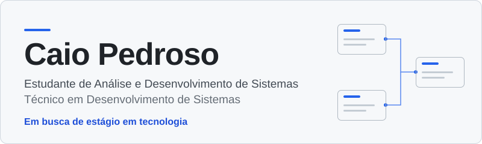

<picture>
  <source media="(prefers-color-scheme: dark)" srcset="assets/banner-dark.svg">
  <source media="(prefers-color-scheme: light)" srcset="assets/banner-light.svg">
  
</picture>

Concluí o curso técnico em Desenvolvimento de Sistemas e hoje estudo Análise e Desenvolvimento de Sistemas na UNICID. Meus projetos até aqui passam por três camadas de um sistema: a interface que a pessoa usa, a API que responde por trás e o modelo de dados que organiza tudo.

Estou buscando um estágio em tecnologia para praticar isso em equipe.

## Trajetória

- **Análise e Desenvolvimento de Sistemas**, UNICID. Em andamento.
- **Curso técnico em Desenvolvimento de Sistemas** (Ensino Médio Integrado). Concluído em dezembro de 2025.

## Tecnologias

| Tecnologia | Onde aparece |
|---|---|
| HTML e CSS | Lixo Invisível e BarberEZ |
| JavaScript | BarberEZ (telas de cadastro, login e agendamento) |
| Node.js e Express | SecureFlow API |
| Python | Scripts do repositório [help-desk](https://github.com/caiopedroso12/help-desk), trabalho multidisciplinar |

## Projetos selecionados

### Lixo Invisível

Site de front-end sobre o lixo que acumulamos sem perceber: arquivos digitais, eletrônicos e embalagens. Trabalho em grupo da disciplina de Desenvolvimento Front-End, com identidade visual própria em preto e verde-limão.

**Tecnologias:** HTML e CSS  
**Estado:** página inicial concluída. Outras páginas estão planejadas e ainda não fazem parte do material.

### SecureFlow API

Exercício de API com Node.js e Express para praticar CORS, registro de requisições e uma rota protegida por token.

**Tecnologias:** Node.js e Express  
**Estado:** projeto de estudo. Os dados ficam em memória e o token está fixo no código, então não serve como solução de segurança para produção.  
**Repositório:** [secureflow-api](https://github.com/caiopedroso12/secureflow-api)

### BarberEZ

Protótipo de interface para uma barbearia, com telas de cadastro, login, agendamento e painel.

**Tecnologias:** HTML, CSS e JavaScript  
**Estado:** protótipo de interface. O código do servidor não está incluído no repositório.  
**Repositório:** [TCC-MarcaEZ](https://github.com/caiopedroso12/TCC-MarcaEZ)

### Modelagem de dados: ERP para loja de roupas

Trabalho acadêmico em grupo da disciplina de Modelagem de Dados. Reúne requisitos, regras de negócio, cardinalidades, dicionário de dados e DER de um ERP para uma loja real de roupas infantis e juvenis.

**Foco:** requisitos e modelagem de dados  
**Estado:** documentação e modelagem. Não é uma aplicação executável.  
**Repositório:** [Trabalho-DER](https://github.com/caiopedroso12/Trabalho-DER)

## Contato

Estou buscando estágio em tecnologia.

- **E-mail:** [caiocruz72@gmail.com](mailto:caiocruz72@gmail.com)
- **LinkedIn:** [linkedin.com/in/caio-pedroso-oliveira](https://www.linkedin.com/in/caio-pedroso-oliveira)
